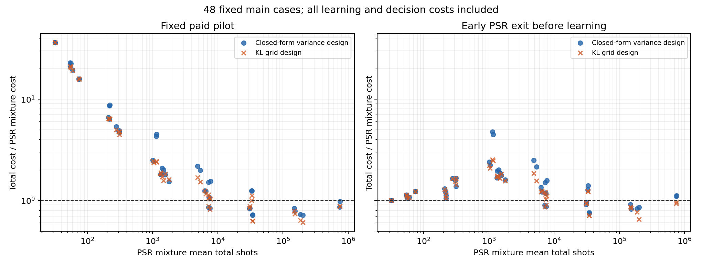

# FaultTune 付费学习与提前验收实验

2026 年 11 月 3 日。把未知参数的学习费用算进去后，当前方法仍未超过标准参数移位法。固定先学习的闭式设计成本为 PSR mixture 的 2.742 倍；加入简单更新提前结束后降至 1.337 倍。本轮最好的 KL 网格方案仍为 1.226 倍。闭式设计与同信息的数值方差设计基本持平，实际优势目前是设计计算更快。

两轮共新增 92,160 条模拟协议轨迹。第二轮的 18,432 条 PSR 对照直接复用第一轮记录，不重复算作新增实验。以下均是软件开发实验，不是独立预注册的 SOTA 确认。

## 实验回答的问题

模型为严格合法的单频 Bernoulli 响应
\[
p(x)=A+B\cos x+C\sin x,\qquad
B^2+C^2<\min(A^2,(1-A)^2).
\]
固定更新宽度 \(h=.2\)，目标损失变化为 \(\Delta=2C\sin(.1)\)。前后噪声通道须与角度无关，观测平稳、每次执行独立且费用相同。目标是带噪观测损失的改善，不是理想门保真度。

主矩阵有 48 个实例：\(A\in\{.01,.05,.2,.5\}\)、半径比例 \(\rho\in\{.5,.98\}\)、\(B/R\in\{0,.9,.995\}\)，以及两种 \(C\) 符号。公共改善门槛为 \(\varepsilon=9\times10^{-5}\)，所有主实例满足 \(|\Delta|\ge9.97085\times10^{-5}>\varepsilon\)。另外保留 16 个 \(|\Delta|=\varepsilon/4\) 的弱信号实例和 8 个零变化实例。这个人工矩阵不是硬件实例分布，也未穷尽单频模型。

每个实例、每种方法运行 128 次，单次错误风险设为 .01，总测量上限为 \(2^{22}\)。相同的总费用检查点按约 1.125 倍增长，共 100 个。学习方法都使用相同四角度数据，每个角度 256 次，共 1,024 次；拟合、角度与分配约束相同，数值网格均为 513 点。真实系数只用于模拟抽样和事后评分，策略与证书接口只接收付费计数。

第一轮先完成全部学习，再用独立数据判断。第二轮先用 PSR 配对数据判断，最多 512 次；仍未结束的实例再支付 512 次轴向测量，补齐四角度学习数据，然后开始独立验收。四种学习方法都享有相同的提前结束机制。每种方法分别承担完整费用，即使比较中共用了同一份模拟学习记录。

第一轮 Fisher 检验对两个方向、100 个检查点分配总风险 .01。第二轮前段 PSR 和后段 Fisher 各使用 .005；条件于所有前段数据，后段观测仍独立，故两段错误风险之和至多 .01。证书使用向外取整的尾概率区间，浮点筛选只允许延后停止，不能单独作出决定。

## 总测量成本

表中数字是 48 个主实例的平均总费用比的几何平均，以不学习的 PSR mixture 为 1，越低越好。费用包括学习、误判前的测量以及弃权时的完整上限；没有只统计成功轨迹。

| 方法 | 固定先学习 | 加入提前结束 |
| --- | ---: | ---: |
| PSR mixture，无学习 | 1.000 | 1.000，复用对照 |
| PSR Fisher，无学习 | 1.098 | 1.098，复用对照 |
| 学习 PSR 的 Neyman 分配 | 2.804 | 1.368 |
| 学习闭式方差设计 | 2.742 | 1.337 |
| 学习数值方差设计 | 2.730 | 1.337 |
| 学习 KL 网格设计 | 2.477 | 1.226 |

提前结束版闭式方案相对 PSR 的成本比为 1.337，探索性 95% bootstrap 区间为 [1.312, 1.362]；KL 网格为 1.226，[1.203, 1.248]。区间在固定 48 个实例内重采样重复标签，保留共用学习数据的相关性；没有提供跨实例总体或同时置信保证。

闭式方案在第二轮 48 个主实例中有 10 个比 PSR mixture 便宜，KL 网格有 12 个。闭式方案最差实例仍贵 4.77 倍，KL 网格最差贵 2.52 倍，不能只宣传少数胜例。提前结束覆盖每种学习方法的 2,067 / 6,144 条主实例轨迹。

第二轮闭式方案与同信息数值方差网格的成本比为 1.0002，区间 [0.9893, 1.0117]，没有测量成本胜出的证据。在本机 384 个设计一批、7 轮计时的微基准中，闭式计算的中位耗时为 0.251 毫秒，513 点方差网格为 9.836 毫秒，约相差 39 倍。这仅比较本机这两个具体实现，不能据此宣称比所有数值优化器更快。

两图均包含全部 48 个主实例；虚线以下表示比 PSR mixture 便宜。

## 错误与弃权

第二轮每种学习方法的 6,144 条主实例轨迹均正确完成，没有弃权。零变化及弱信号实例仍有错误和大量弃权，全部保留：

| 第二轮方法 | 全部 9,216 条中的误判 | 1,024 条零变化中的误判 | 2,048 条弱信号中的弃权 |
| --- | ---: | ---: | ---: |
| PSR mixture，复用 | 10 | 6 | 2,027 |
| PSR Fisher，复用 | 7 | 4 | 2,005 |
| 学习 PSR 的 Neyman 分配 | 3 | 2 | 2,006 |
| 学习闭式方差设计 | 3 | 3 | 1,986 |
| 学习数值方差设计 | 4 | 4 | 1,995 |
| 学习 KL 网格设计 | 1 | 1 | 1,989 |

正确性保证来自模型条件下的检验论证。每实例仅 128 次重复，零误判也不足以从经验上确认该实例错误率低于 1%；更不能把主实例的完成率当作所有参数、所有有限预算都达到 95% 功效的证明。弱信号与零变化实例不纳入主效率分数，其结果仍完整公开。

## 目前能够成立的研究结论

1. **付费学习会改变方法排名。** 理论上的已知参数最优方差并不保证未知参数下的总费用优势。固定学习开销伤害容易判断的更新，有限学习数据的拟合误差还会影响角度选择。
2. **闭式设计主要替代数值方差搜索。** 它在当前比较中节省计算时间，但没有超过同信息数值设计的测量效率。KL 设计更贴近符号检验，在本轮平均费用上优于方差设计。
3. **大幅收益不宜继续押注只改采样比例。** 已有 Shulman–Feder 定理表明，固定两个角度后的 KL 最优分配，相对均匀分配的信息率增益至多约 6.15%。这是信息率边界，不能直接当成有限预算费用边界。
4. **更强的理论目标已经具体化。** “两个对称角度达到允许全部角度的信息极限”有一个可核查的充分条件，并已证明 \(B=0\) 特例。60 个结构点和 1,000 个随机点未发现一般情形反例，但全域不等式尚未证明。详见[理论边界](LEARNED_VALIDATION_THEORY.md)。

PSR、广义参数移位、最优实验设计及结构化 KL 识别均已有成熟文献。同信息的数值方差/KL 网格是本次强对照，但不是完整的自适应结构化识别 SOTA 实现。当前不能使用“已超过 SOTA”或“普遍节省测量”的宣传。

## 下一项实现与验收

优先实现**学习过程中保留同一个有效证据过程**：根据已经观察的数据改变下一对对称角度，并把早期与后期配对观测共同用于证书，减少分段风险与丢弃证据的费用。该路线的有效性需要依赖共同的符号方向与可预测选角；不能直接把原先的独立同分布假设删掉。对应的专门论证见[自适应配对证据引理](ADAPTIVE_PAIRED_EVIDENCE_LEMMA.md)。

新控制器应与同样可复用证据的标准 PSR、数值选角控制器比较，并继续计入用于学习的额外轴向测量。配对符号统计会忽略一致结果中的信息，其有限差距信息率不一定等于 Fisher 两样本 KL 目标；必须优化和比较实际使用的统计量。先在同一开发矩阵检查总成本和最差退化，只有整体优势出现后，才冻结新实例与种子做独立确认。已有两轮数据保留，不用更换种子掩盖负结果。

理论工作集中证明两点 KL 最优性的全域不等式及候选零假设合法性；若只能得到数值结果，下一步应做连续角度的区间认证，而不是继续加密网格。

## 可复现证据

第一轮 55,296 条账本、37,209 个决定证书及 18,087 个最终弃权证书全部重算；432 个单元汇总一致，2,304 条整批种子重放逐字段一致。第二轮独立审计核对全部 55,296 条账本：8,276 个提前结束证书、16,526 个后段决定及 12,062 个最终弃权证书全部重算，28,588 个后段设计与所有前段抽样重现，1,536 条完整轨迹重放一致；18,432 条对照逐字段核对原账本。31 个旧冻结源码与之前 18 项单频探索清单保持不变。

- [第一轮规格、结果与审计](../results/learned_validation/development_v1/summary.json)，[audit](../results/learned_validation/development_v1/audit.json)
- [第二轮规格、结果与审计](../results/learned_validation/development_v2/summary.json)，[audit](../results/learned_validation/development_v2/audit.json)
- [全部比值、分层结果与 bootstrap 区间](../results/learned_validation/comparison.json)
- [Fisher 证书独立检查](../results/learned_validation/certificate_checks.json)，[KL 设计检查](../results/learned_validation/kl_design_checks.json)
- [本机设计计算计时](../results/learned_validation/planning_benchmark.json)
- [第一轮程序](../experiments/learned_validation/run_validation.py)，[第二轮程序](../experiments/learned_validation/run_adaptive_validation.py)

运行环境为 Python 3.8.3、NumPy 1.18.5、SciPy 1.5.0。两个程序都会拒绝覆盖已有规格文件，重跑应指定新的输出目录；原始账本按实例、方法、重复编号记录计数、种子、费用和证书。
