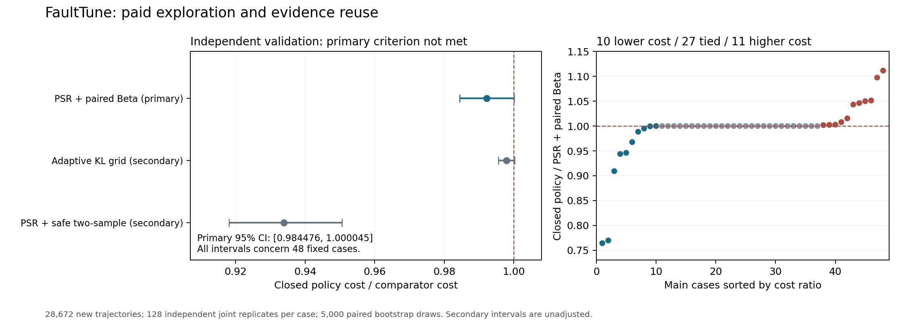

# FaultTune：流式证据复用、付费选角与独立验证

2026 年 11 月 3 日。本轮新增 **157,696 条模拟协议轨迹**，完成全量审计。预先冻结的独立验证**未通过**主优越性标准：闭式方案相对 PSR Beta 的总测量成本比为 **0.992238**，95% bootstrap 区间为 **[0.984476, 1.000045]**。上界仍大于 1，不能称为已确认的测量成本优势，更不能称为超过完整 SOTA。

本轮可保留的实质进展是：所有付费数据可用于持续学习和证据积累；闭式选角的本机计算显著更快；在明确的模型与投影条件下，已推导出付费学习后的渐近信息率保证。有限预算下的测量收益仍需改进。

## 独立验证结果

在观察验证结果前，冻结了[验证计划](../results/streaming_validation/holdout_plan.json)、四种方法、48 个新主实例、8 个零变化实例、每格 128 次重复、全部种子及验收规则。没有依据验证结果修改控制器、增加重复数或重抽 bootstrap。该计划是本地前瞻冻结，不是公开预注册。

主指标先计算每个实例的无条件平均总测量次数，再对 48 个成本比取等权几何平均；错误停止、探索和达到预算上限的弃权均计费。每次重复使用独立随机流，三种 Beta 方法在同一次重复内共享随机流；5,000 次 bootstrap 在实例内联合重采样重复编号，保留方法间相关性。区间描述这 48 个固定实例的 Monte Carlo 不确定性，不能解释为任意新实例总体的保证。

| 闭式方案 / 对照 | 总测量成本比 | 95% bootstrap 区间 | 结论 |
| --- | ---: | ---: | --- |
| PSR Beta，预定主指标 | 0.992238 | [0.984476, 1.000045] | 未通过 |
| 相同历史数据的自适应 KL 网格 | 0.997859 | [0.995544, 1.000217] | 未确认优越性 |
| PSR 加安全两样本检验 | 0.933899 | [0.918075, 0.950598] | 描述性次指标，未作多重比较校正 |

PSR Beta 和闭式方案的主实例几何平均成本分别为 1,531.87 与 1,519.98 shots。相对 PSR Beta，闭式方案在 10 个实例更省、27 个完全相同、11 个更费。最佳实例节省 23.58%，最差增加 11.15%。因此整体 0.78% 的点估计同时包含局部收益与回退，不能只报告最佳实例。

| 方法 | 主实例错误 / 6,144 | 主实例弃权 | 零变化错判 / 1,024 | 零变化弃权 |
| --- | ---: | ---: | ---: | ---: |
| PSR Beta | 1 | 0 | 3 | 1,021 |
| PSR Safe | 0 | 0 | 4 | 1,020 |
| 闭式 Beta | 1 | 0 | 3 | 1,021 |
| KL 网格 Beta | 1 | 0 | 4 | 1,020 |

三种 Beta 方法的那次主实例错误来自探索前的同一条随机轨迹。所有错误保留在成本与风险汇总中；没有把审计通过说成零错误。每格 128 次重复也不足以经验认证逐实例 1% 风险界。风险依据仍是条件独立、固定单频结构、可预测选角和经认证停止下的数学论证。

原始结果见[固定分析](../results/streaming_validation/holdout_v1/analysis.json)、[逐格汇总](../results/streaming_validation/holdout_v1/summary.json)与[审计](../results/streaming_validation/holdout_v1/audit.json)。

## 本轮改进了什么

实验模型为 \(p(x)=A+B\cos x+C\sin x\)，独立 Bernoulli 测量，角度查询等价计费，目标为固定中点两侧差值的符号。噪声与参数在一次轨迹内固定，尚未覆盖漂移、角度依赖误差、硬件或整个优化循环。

原先学习与验证分离，试探性测量不进入最终证据。本轮使用[自适应配对证据引理](ADAPTIVE_PAIRED_EVIDENCE_LEMMA.md)，允许每对 \(\pm t\) 由此前结果选定，同时把所有配对保留在拟合与符号证据中。延后探索版先运行 PSR，超过 4096 shots 后持续补足平方根规模的两角探索，再用闭式角度完成本块余下测量；全部开销计入总成本。

这里认证的是共同方向。角度变化后，证书中的合并 pair contrast 不再是原目标差值 \(2C\sin(0.1)\) 的幅度估计，不能据此宣称已认证目标改进量。

| 开发阶段 | 闭式方案 / 同期 PSR Beta 成本 |
| --- | ---: |
| 旧固定学习后独立验证 | 2.742 |
| 旧提前结束后独立验证 | 1.337 |
| 本轮立即探索、持续复用 | 0.9804 |
| 本轮延后且持续探索 | 0.9686 |
| 新参数、新种子的独立验证 | 0.9922 |

前四行用于描述开发过程；最后一行是不同新参数矩阵上的前瞻验证，不能把这些数值当作同一次独立实验的连续改进。开发批次共享单元级随机流，自适应分支后重复编号不保证独立成对；其配对 bootstrap 仅作描述性参考。新验证改为每个重复单独运行，修复了该不确定性分析问题。

开发集还运行了可预测 Kelly、安全两样本证据及固定两臂 Track-and-Stop 对照。后者在开发主矩阵为 PSR Beta 成本的 1.624 倍，但不使用全角度共同的三参数结构，不能据此宣称战胜结构化识别 SOTA。[开发比较](../results/streaming_validation/comparison.json)保留全部方法。

## 可以证明的理论结果

[全角度 KL 理论](STREAMING_KL_THEORY_NOTE.md)给出一个显式信息率近似界。令
\[
\eta=\frac{|C|}{\sqrt{\min(A,1-A)^2-B^2}},\qquad
F(\eta)=\frac{\eta+(1-\eta)\log(1-\eta)}{\eta^2}.
\]
使用真实 \(A,B\) 的闭式对称两角设计，其完整数据 oracle 信息率 \(I_0\) 满足
\[
\frac{I_*}{I_0}\le 2F(\eta)<2,
\]
其中 \(I_*\) 允许全部角度。当 \(\eta\le0.1\) 时保留至少 **96.608%** 的最优信息率；实际采用的配对符号 Beta 证据对应至少 **95.652%**。一般精确两点最优性和具体定理的文献首创性仍未确定。

[付费学习的渐近推导](STREAMING_LEARNED_ASYMPTOTIC_NOTE.md)进一步补上未知参数：两种固定探索角使 Gram 最小特征值按 \(\sqrt n\) 增长；自归一化鞅论证给出岭拟合强一致性；探索比例消失，利用角收敛，合并 Beta 证据的每 shot 对数增长率趋于该极限角的信息率。

若真实参数满足
\[
10^{-4}\le A\le1-10^{-4},\qquad
\sqrt{B^2+C^2}\le0.98\min(A,1-A),
\]
则投影极限为真参数，付费学习后的无限数学延伸可继承上述 **95.652%** 保证，但仍要求额外的 \(\eta\le0.1\)。这些条件不能省略。当前 0.98 径向投影还保证闭式角度落在约 \([0.614,\pi-0.614]\)，所以 0.2 角度截断对这个闭式策略不生效。

这证明的是无限数学延伸的渐近证据增长率；固定 \(2^{22}\) 上限的代码、固定精度计算、有限预算测量成本以及期望停止时间均不能直接继承该结论。理论不能替代独立验证未通过这一事实。

## 计算优势及其范围

从已支付测量得到的历史中机械选取 384 个拟合状态，比较同一个方差目标，拟合时间对所有方法一律排除。使用 SciPy bounded 的实用默认容差 \(10^{-5}\)，并在余弦坐标优化和检查端点。7 轮计时的中位数为：

| 选角实现 | 每 384 个状态时间 | 相对闭式 |
| --- | ---: | ---: |
| 标量闭式 | 0.626 ms | 1 |
| 标量 SciPy bounded | 71.864 ms | 114.7 |
| 向量闭式 | 0.084 ms | 1 |
| 调优后的向量 513 点方差网格 | 3.396 ms | 40.4 |

最大相对方差目标差为 \(4.35\times10^{-12}\)。这是特定实现、本机背景负载下的选角微基准，不能表述为总运行速度或测量效率提升 40–115 倍。详见[计算比较](../results/streaming_validation/planning_comparison.json)。

## SOTA 定位与下一项工作

可保留的简洁故事是：**边测边学，复用每次测量，用闭式选角逼近信息极限。** “接近极限”必须附带上述模型、参数范围和渐近含义；目前还没有可支撑“整体测量成本国际领先”的独立证据。

文献对照包括 Turner–Ly–Grünwald 的安全两样本方法、Degenne–Koolen–Ménard 的结构化纯探索，以及 2026 年的 [Overshifted Parameter-Shift Rules](https://arxiv.org/abs/2510.05289)。后者已研究移位优化和异方差 Neyman 分配，不能把“优化移位”或“按方差分配”本身作为创新。具体公式和信息率界是否已有先例仍需定向文献核查，详见[SOTA 定位](STREAMING_SOTA_POSITION.md)。

下一项最值得实施的工作是**同单频结构、全 Bernoulli 计数、全角度的强对照与证据过程**：用此前数据的预测似然作分子，对反号三参数物理模型的最大似然作分母，并为该最大值计算可信上界，使停止规则可审计。同时实现结构化信息设计，比较闭式方案的测量成本与规划时间。这样才能分清限制来自学习、证据压缩，还是角度设计本身。

下一轮应另建开发材料及全新验证集，预先固定主对手和指标。当前验证集已经看过，不能再充当新控制器的独立确认。后续目标仍是可复现地超过最强同信息实现；在此之前，只报告已证明的信息率界和本机计算优势。

## 审计与复现入口

| 数据批次 | 新轨迹 | 审计历史块 | 完整种子重放 |
| --- | ---: | ---: | ---: |
| 流式开发 v1 | 82,944 | 4,910,553 | 3,456 |
| 持续探索开发 v2 | 36,864 | 3,955,154 | 1,536 |
| 固定两臂 Track-and-Stop | 9,216 | 574,370 | 24 |
| 前瞻独立验证 | 28,672 | 1,601,522 | 110 |
| 合计 | **157,696** | **11,041,599** | **5,126** |

开发 v2 引用的 18,432 条既有对照没有重复计为新轨迹。全部最终证书及成本重算通过；独立验证的 110 条重放包括全部 17 条错误记录。之前 39 个证据文件及 31 个冻结 Python 源均逐项保持不变。

复现顺序为各运行器、对应审计器、固定分析器，再运行[证据打包脚本](../experiments/streaming_validation/finalize_evidence.py)。现有结果的只读验证命令：

~~~powershell
& 'D:\softwares\anaconda\anaconda\python.exe' -B experiments/streaming_validation/finalize_evidence.py --verify-only
~~~

[证据清单](../results/streaming_validation/evidence_manifest.json)记录源文件、结果、文档及审计哈希；[源码快照](../results/streaming_validation/streaming_validation_sources.zip)包含运行和分析所需的本地研究源码。两个文件由本轮收尾生成。证据冻结后若继续研究，应新建版本，保留这次未通过的验证结果。
